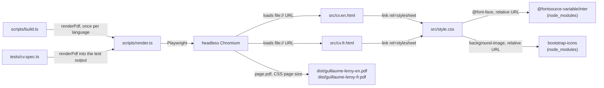

# Architecture

## Overview

The résumé is two static HTML documents and one stylesheet. A small TypeScript script drives headless Chromium
through Playwright and prints each document to an A4 PDF, so the page shown in a browser and the PDF come from the
same source and the same rendering engine.

## Components

- **[src/cv.en.html](src/cv.en.html), [src/cv.fr.html](src/cv.fr.html)** — the content, one document per language,
  with the same markup structure: the same classes and the same number of entries. They contain no script.
- **[src/style.css](src/style.css)** — the layout for screen and print. The base styles are the narrow single-column
  layout; from `48rem` the side column moves next to the main one. The print rules define an A4 page with 12 mm
  margins, a main column (profile, experience) and a 31 % side column (skills, open source, teaching, community,
  education, languages), keep each job and side item on one page, and hide the language switch.
- **[src/photo.jpg](src/photo.jpg)** — the portrait in the header of both languages: 480 px square, enough for the
  26 mm it prints at (about 300 dpi), and small enough not to weigh on the repository or the PDFs.
- **[scripts/render.ts](scripts/render.ts)** — the list of languages, the source URL and the PDF path of each, and
  `renderPdf`: open the page, wait for the fonts, print with the CSS page size and backgrounds.
- **[scripts/build.ts](scripts/build.ts)** — the `npm run build` entry point: launches one Chromium and renders every
  language into `dist/`.
- **[scripts/log.ts](scripts/log.ts)** — JSON-lines logger writing to stderr, filtered by `RESUME_LOG_LEVEL`.
- **[tests/cv.spec.ts](tests/cv.spec.ts)** — Playwright tests on the loaded pages and the printed PDFs; they enforce
  the invariants below.
- **[scripts/release.sh](scripts/release.sh)** — writes a release version into `package.json` and
  `package-lock.json`, commits and tags it.

## Design decisions

**One hand-written HTML file per language, rather than a template fed by data files.** With two languages the
repeated markup is small, each page opens in a browser with no build step, and the phrasing of an entry can differ
between languages instead of being forced into identical slots. The drift this duplication allows — an entry added
in one language only — is caught by a test comparing the two documents' structure.

**Chromium through Playwright, rather than a dedicated HTML-to-PDF engine** such as WeasyPrint or wkhtmltopdf, or a
typesetting system such as Typst or LaTeX. The PDF is exactly what a current browser prints, so grid, flexbox and
fragmentation control behave the same on screen and on paper, and the tests run against the engine that produces the
published files. The cost is a browser download of a few hundred megabytes to build.

**The font and the logos are npm dependencies, neither system assets nor hosted web resources.** Inter is loaded from
`node_modules` through a relative `@font-face` URL, so a macOS laptop and a Linux runner break lines identically — and
therefore produce the same number of pages — without network access at render time. The LinkedIn and GitHub logos
come from `bootstrap-icons` the same way, as CSS background images, so no SVG path is copied into the sources. They
keep their own black fill rather than following the palette: tinting them would take a `mask-image`, which Chromium
fetches with CORS, and a page opened from `file://` has no origin to pass that check.

**TypeScript runs directly on Node through type stripping**, with no compile step; `tsc --noEmit` only checks types.
Imports keep their `.ts` extension for that reason, and the code sticks to erasable syntax.

**PDF file names carry no version**, so `releases/latest/download/<name>` is a stable link to the current résumé.

## Invariants and constraints

These are checked by [tests/cv.spec.ts](tests/cv.spec.ts):

- **Each PDF fits on at most two A4 pages.** New content is paid for by cutting elsewhere or tightening the print
  styles.
- **Both languages have the same structure**: the same number of sections, jobs, roles, skill groups, skill tags and
  side-column items. A change to one language lands in the other in the same change.
- **Each page loads with no console error and no failed request, renders with Inter** rather than a fallback font,
  **its photo loads, and its LinkedIn and GitHub logos point at SVG files that exist.**
- **Every link is `https://`, `mailto:` or the other language's page.** A PDF leaves the repository, so any other
  relative link would be dead in it.

## Limitations

- The PDFs are not tuned for applicant tracking systems: text extraction follows the DOM order (main column, then
  side column), and there is no plain-text or DOCX version.
- Opened from a checkout without `node_modules`, the HTML falls back to a system font and its layout differs from the
  PDF.
- The HTML itself is not published anywhere; only the PDFs are.
